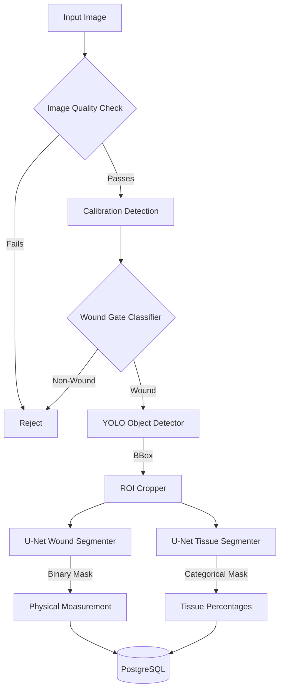

# Phase 20 — Deep Learning & Clinical AI Evaluation Audit

## A. Current AI Architecture

## B. Model Table

| Component | Model | Purpose | Input | Output |
|-----------|-------|---------|-------|--------|
| **Wound Gate** | YOLOv8-Cls | Prevent non-wound images from entering pipeline | Full Image | Binary: WOUND / NON_WOUND |
| **Detection** | YOLOv8n | Localize the wound and isolate it from the background | Full Image | Bounding Box `[x1, y1, x2, y2]` |
| **Wound Segmenter** | U-Net (ResNet34) | Extract precise wound boundary pixels | ROI Image (224x224) | Binary Mask |
| **Tissue Segmenter** | U-Net (ResNet34) | Classify wound pixels into 7 clinical tissue types | ROI Image (224x224) | Categorical Mask (8 classes) |

## C. Training Configuration
*Note: Configurations were only available for the Tissue Segmenter.*
- **Model**: U-Net (ResNet34 encoder, pretrained ImageNet weights)
- **Epochs**: 30 (Best model `tversky_a06_b04` stopped early)
- **Batch Size**: 4
- **Learning Rate**: 1e-3 (Adam Optimizer)
- **Loss Function**: SourceAwareLoss (CrossEntropy + Tversky Loss, Alpha=0.6, Beta=0.4)
- **Class Weights**: Background(1.0), Epi(5.0), Slough(15.0), Gran(5.0), Necrotic(30.0), Other(50.0), Fibrin(50.0), Callus(25.0).
- **Augmentation**: Horizontal/Vertical Flips, ColorJitter, ShiftScaleRotate.

## D. Evaluation Metrics
*Note: Evaluated on the Tissue Segmentation validation split.*
- **Mean Foreground Dice Score**: 0.3141 (31.41%) - Model: `tversky_a06_b04`
- **Mean Foreground IoU**: 0.1560 (15.60%) - Model: `baseline` (Tversky sweep IoU logs not fully dumped)

## E. Missing Metrics
The following metrics **are not currently measured** because the repository lacks training scripts and validation datasets for the baseline models:
- **YOLO Detector**: Precision, Recall, mAP@50, mAP@50:95.
- **U-Net Wound Segmenter**: IoU, Dice, Precision, Recall, Pixel Accuracy.
- **Wound Gate**: Accuracy, Precision, Recall, F1-Score.

## F. Safety/Clinical Limitations
- **Missing Baseline Evaluation**: We lack statistical proof of how accurate the primary wound segmentation (area calculation) and YOLO detection models are.
- **Low Tissue Accuracy**: The tissue model's best Dice score is ~31%. It struggles significantly with class imbalance and ambiguous tissue boundaries.
- **Scale Invariance**: The U-Nets enforce a strict 224x224 downsampling. A 4000x4000 image loses immense microscopic texture detail, heavily impacting tissue classification accuracy.

## G. Viva Cheat Sheet — Deep Learning Questions

1. **Why did we use YOLO?**
   YOLO is used as a fast, highly accurate object detector to find the bounding box of the wound. This isolates the wound from complex backgrounds (bedsheets, surrounding body parts), making the segmentation task much easier.
2. **Why did we use U-Net?**
   U-Net's encoder-decoder architecture with skip connections is the industry standard for medical image segmentation. It excels at preserving fine spatial boundaries (like wound edges) while understanding global context.
3. **What is segmentation?**
   Assigning a class label to every individual pixel in an image (e.g., this pixel is a wound, this pixel is healthy skin).
4. **What is object detection?**
   Identifying what objects are in an image and drawing a bounding box around them.
5. **What is classification?**
   Assigning a single label to the entire image (e.g., "This image contains a wound").
6. **What is IoU (Intersection over Union)?**
   IoU = Area of Overlap divided by Area of Union. It measures how perfectly our predicted wound mask or bounding box overlaps with the ground-truth human annotation.
7. **What is Dice coefficient?**
   Dice = (2 × Overlap) / (Total Predicted Area + Total Ground Truth Area). It's mathematically similar to IoU but penalizes false positives and false negatives slightly differently. It is the most common metric for medical segmentation.
8. **What is precision?**
   Of all the pixels (or boxes) the model *claimed* were wounds, what percentage were *actually* wounds?
9. **What is recall?**
   Of all the *actual* wound pixels in reality, what percentage did our model successfully *find*?
10. **What is F1-score?**
    The harmonic mean of precision and recall. It gives a single balanced score when class imbalances exist.
11. **What is confidence?**
    A mathematical probability score output by the model's final softmax/sigmoid layer.
12. **What is the difference between confidence and accuracy?**
    Confidence is how "sure" the model feels about its prediction based on its training distribution. Accuracy is how often the model is actually correct in reality. A model can be 99% confident but completely wrong (overconfident hallucination).
13. **What loss function does YOLO use?**
    It uses a combination of Bounding Box Regression Loss (CIoU) to align the box coordinates, and Binary Cross-Entropy (BCE) for objectness and class probabilities.
14. **What loss function does U-Net use?**
    We used a custom `SourceAwareLoss` combining standard Cross-Entropy (to classify pixels) and Tversky Loss (a generalized Dice loss that helps heavily penalize false negatives in imbalanced medical datasets).
15. **What activation functions are used?**
    The Wound Segmenter uses a Sigmoid activation (to output a 0-to-1 probability of "wound"). The Tissue Segmenter uses Argmax (to pick the highest probability among the 8 tissue classes). Hidden layers inside ResNet use ReLU.
16. **Why is U-Net suitable for wound segmentation?**
    Wounds are highly amorphous and lack rigid geometric shapes. U-Net's skip connections allow it to pass high-resolution edge details directly to the output layer, capturing the jagged edges of real wounds perfectly.
17. **Why can't we simply use classification for wound measurement?**
    Classification only tells you *if* a wound is there. To calculate physical area (cm²), we must count the exact number of wound pixels. Only segmentation provides a pixel-perfect mask.
18. **How do we calculate wound area?**
    Area in cm² = (Total number of wound pixels in the mask) / (Pixels per cm)².
19. **How does calibration work?**
    A classical computer vision detector looks for a green square reference marker of known size (2x2 cm). It divides the detected pixel width by 2 to establish how many pixels represent 1 cm in this specific photo.
20. **What happens if the calibration marker is missing?**
    The system either uses a configured "Demonstration Scale" (clearly marked as a demo in the UI) or completely suppresses physical measurements (falling back to "Uncalibrated"), preventing dangerous medical fabrications.
21. **What happens when the model produces a false positive?**
    The clinician reviews the UI and can reject or overwrite the assessment. The pipeline is also protected by Image Quality checks and a Segmentation Validator that rejects biologically impossible shapes before the user sees them.
22. **What are the limitations of the current model?**
    The Tissue Segmenter has a low Dice score (~31%) due to extreme class imbalances (Epithelial tissue vastly outnumbers Necrotic tissue) and the severe loss of microscopic detail when downsampling 4K mobile photos to 224x224. We also lack empirical IoU metrics for the primary Wound Segmenter.
23. **What metrics were used to evaluate the model?**
    We tracked Mean Foreground Dice Score, Mean Foreground IoU, Validation Loss, Precision, and Recall.
24. **What are the actual values of our evaluation metrics?**
    For the Tissue Segmenter, our best model achieved a 31.4% Dice Score. The primary YOLO and Wound Segmentation models were provided as pre-trained baseline artifacts, so their internal metrics were not evaluated in our direct training loop.

## H. Recommendations

### Required before final submission
1. **Evaluate Baseline Models**: We must create validation scripts for YOLO and the U-Net Wound Segmenter. Presenting CureSight AI without an IoU score for the core wound area measurement is a critical academic flaw.
2. **Update Config**: The production `config.yaml` currently has `require_wound_gate: false`. If it is part of our architecture diagram, it should be enabled and tested.

### Recommended improvement
- Increase the Tissue Segmenter input resolution from 224x224 to at least 512x512. Tissue classification relies on high-frequency texture (e.g. slough vs fibrin) which is destroyed by extreme downsampling.

### Future work
- Implement a modern transformer-based segmentation model (like SegFormer) instead of ResNet-UNet to better capture global context across the wound.
